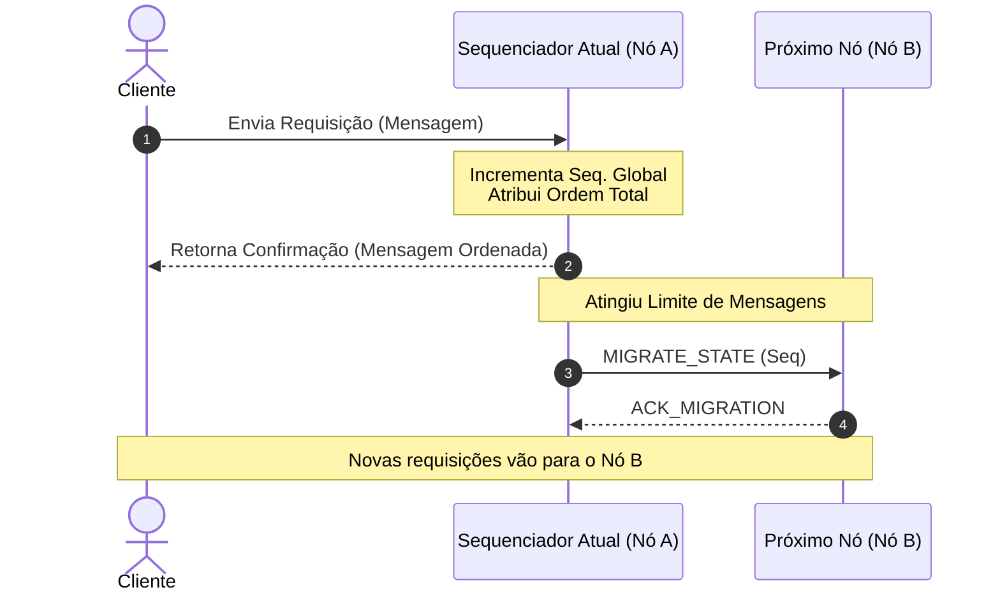

# Trabalho Prático: Implementação de Sequenciador Móvel (Mobile Sequencer)

**Disciplina:** Sistemas Distribuídos — UFSC Araranguá (2026/2)  
**Acadêmica:** Nena António Impanta  
**Professor:** Jim Lau  

---

## 1. Descrição da Proposta
O objetivo deste trabalho prático é implementar um serviço distribuído baseado no protocolo de **Sequenciador Móvel** (*Mobile Sequencer*). 

Em sistemas distribuídos, assegurar a ordenação total de mensagens (*Total Order Multicast*) é fundamental para manter o estado consistente entre múltiplos nós. Enquanto um sequenciador estático centraliza toda a ordenação em um único componente fixo — criando um ponto único de falha (*Single Point of Failure*) —, o **sequenciador móvel** confere dinamismo e tolerância à arquitetura: o papel de coordenador (responsável por atribuir os números de sequência globais) **migra dinamicamente** entre os nós participantes da rede após um limite configurado de requisições processadas.

---

## 2. Requisitos Funcionais e Arquitetura
* **Processos / Nós Distribuídos:** Cada nó executa instâncias independentes ouvindo em portas TCP distintas (a partir de uma porta base, ex: `5000` e `5001`).
* **Cliente:** Envia transações ou mensagens de texto via socket TCP para o nó que estiver atuando como sequenciador ativo no momento.
* **Sequenciador Ativo:** Recebe a requisição, incrementa a variável global de controle de ordenação (`sequence_number`), carimba a ordem total e retorna a confirmação ao cliente.
* **Mecanismo de Migração de Papel:** Ao atingir o limite estipulado (`migration_limit`), o nó atual empacota o estado atual do contador de sequência e o transfere via socket para o próximo nó da cadeia, que assume imediatamente o papel de sequenciador móvel.

---
## 3. Comunicação entre Cliente e Servidor (Diagrama de Sequência)

Abaixo está o diagrama de sequência gerado via Mermaid, detalhando a interação entre o cliente, o sequenciador móvel atual e o próximo nó durante a migração de estado:




#### 4. Descrição do Serviço e Execução do Algoritmo
O serviço foi implementado em Python 3 utilizando sockets TCP nativos (socket) e concorrência orientada a eventos por meio de threads (threading), garantindo que cada nó possa atuar simultaneamente como servidor de requisições, cliente e receptor de migrações de estado.

Trechos de Código Principais

#### A. Recepção de Mensagens e Controle de Sequenciamento (Servidor)

```python
if self.is_sequencer:
    self.sequence_number += 1
    self.message_count += 1
    resposta = f"[ORDEM GLOBAL #{self.sequence_number}] Mensagem: '{data}' (Processada pelo Sequenciador Nó {self.node_id})"
    conn.send(resposta.encode('utf-8'))
    
    # Gatilho de migração do papel móvel
    if self.message_count >= self.migration_limit and self.next_port:
        self._trigger_migration()
else:
    conn.send(f"ERRO: O Nó atual não é o sequenciador ativo.".encode('utf-8'))
```


B. Protocolo de Transferência e Migração de Estado

```python
def _trigger_migration(self):
    print(f"[ MIGRAÇÃO] Transferindo papel para a porta {self.next_port}...")
    self.is_sequencer = False
    self.message_count = 0
    
    mig_sock = socket.socket(socket.AF_INET, socket.SOCK_STREAM)
    mig_sock.connect((HOST, self.next_port))
    mig_sock.send(f"MIGRATE_STATE:{self.sequence_number}".encode('utf-8'))
    mig_sock.recv(1024)
    mig_sock.close()
```


5. Procedimentos de Instalação, Configuração e Execução
Como a aplicação é desenvolvida inteiramente em Python nativo, nenhuma biblioteca externa ou instalação complexa é necessária, tornando-o ideal para execução local ou em ambientes de nuvem leve (como o Google Colab).

Executando no Google Colab (Sem uso de espaço local)
Para testar e validar o código diretamente no navegador sem ocupar armazenamento no computador:

Acesse o Google Colab.

Crie um novo notebook, cole o código do arquivo sequenciador_movel.py e execute a célula para ver os nós subindo e a migração automática do sequenciador em tempo real.

6. Referências Bibliográficas
TANENBAUM, Andrew S.; VAN STEEN, Maarten. Sistemas Distribuídos: Princípios e Paradigmas. 2. ed. São Paulo: Pearson Prentice Hall, 2007.

COULOURIS, George; DOLLIMORE, Jean; KINDBERG, Tim. Sistemas Distribuídos: Conceitos e Projeto. 4. ed. Porto Alegre: Bookman, 2013.

UNIVERSIDADE FEDERAL DE SANTA CATARINA (UFSC) - Campus Araranguá. Enunciado do Trabalho Prático: Sistemas Distribuídos. Professor Jim Lau, 2026.
